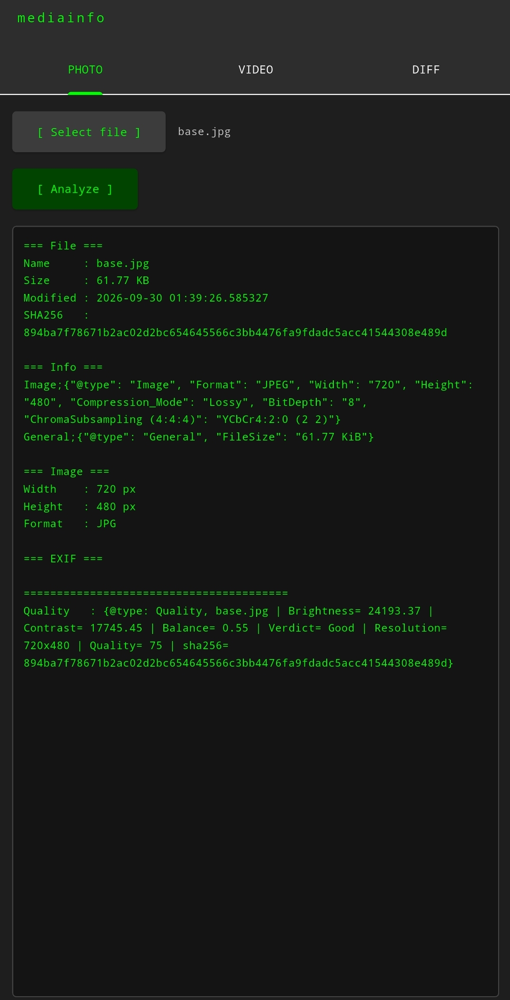
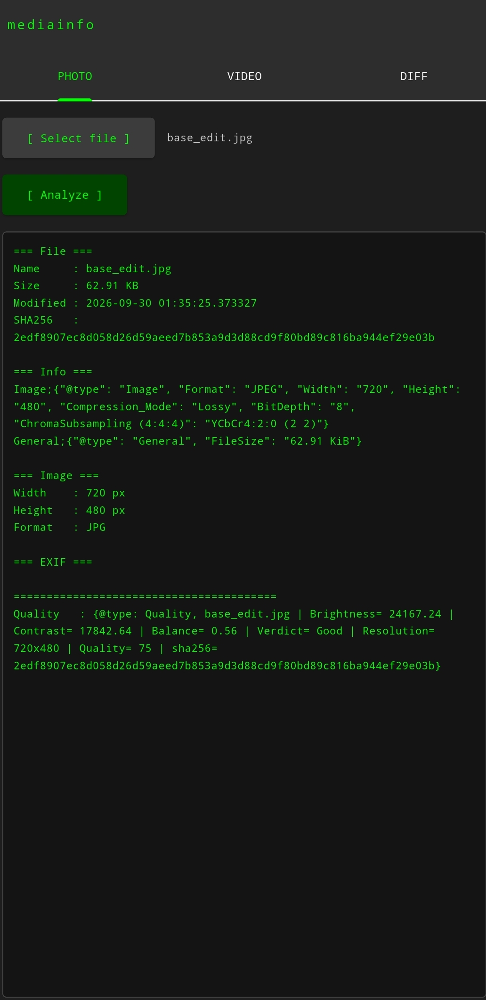
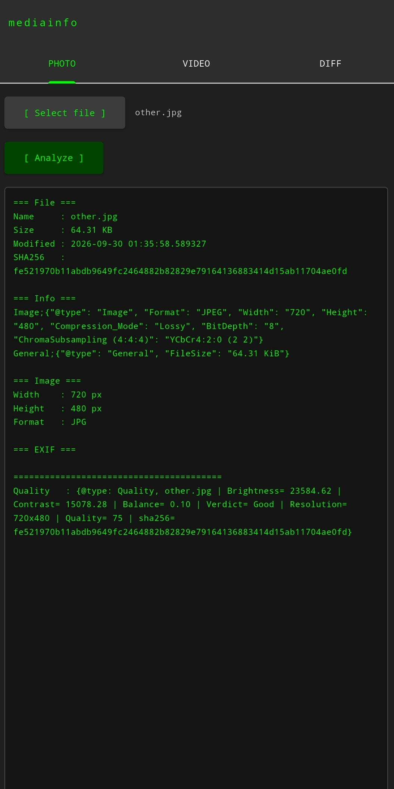
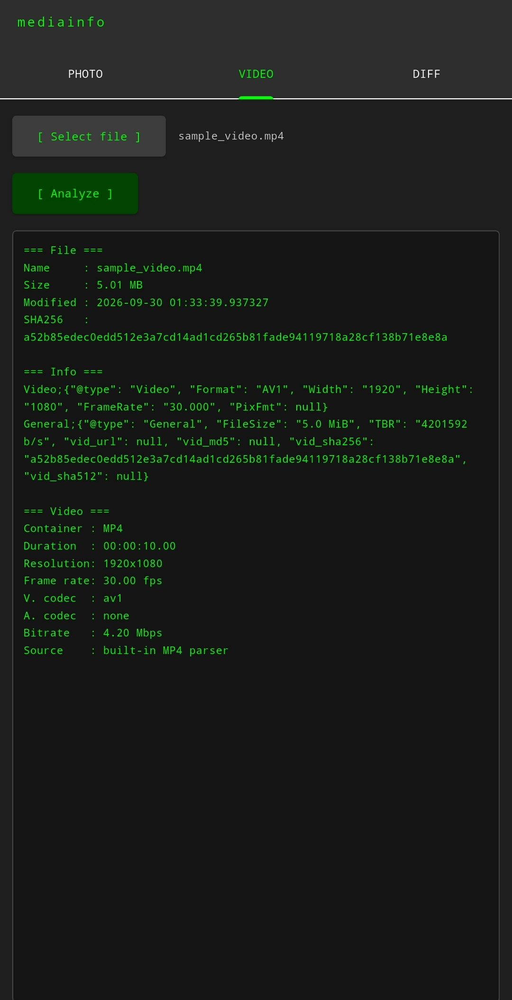
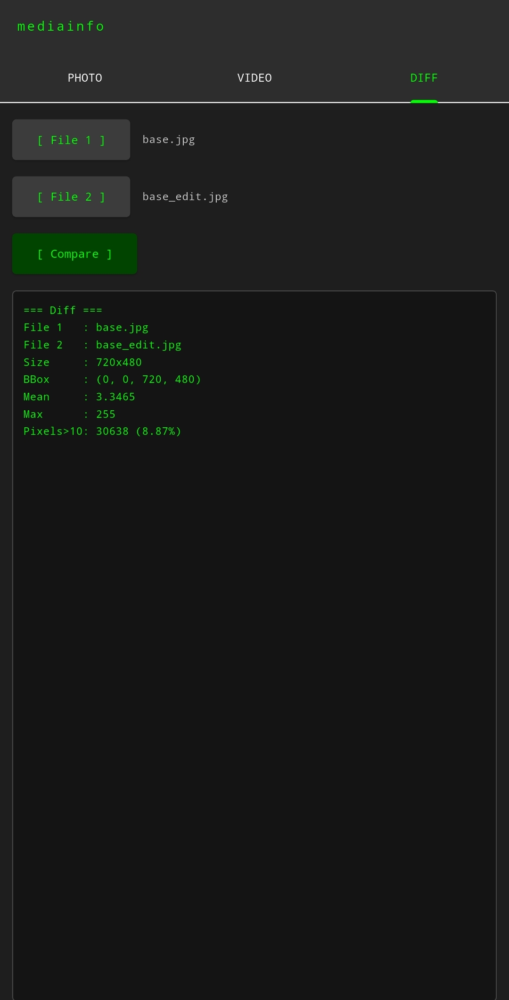

## Getting Started

This project is a starting point for a Flutter application.

A few resources to get you started if this is your first Flutter project:

- [Learn Flutter](https://docs.flutter.dev/get-started/learn-flutter)
- [Write your first Flutter app](https://docs.flutter.dev/get-started/codelab)
- [Flutter learning resources](https://docs.flutter.dev/reference/learning-resources)

For help getting started with Flutter development, view the
[online documentation](https://docs.flutter.dev/), which offers tutorials,
samples, guidance on mobile development, and a full API reference.

# mediainfo_custom

A lightweight Flutter app for inspecting photo and video metadata, with a terminal-style interface. Runs on Android, and on desktop with extra ExifTool support.

## Features

- **Photo analysis**
  - Image dimensions (width / height) and format
  - Key EXIF fields: camera make and model, date/time, exposure time, aperture (F-number), ISO, focal length, GPS coordinates
  - EXIF section is hidden automatically when the photo has no matching data
- **Video analysis**
  - Basic video information such as resolution, duration, and codec
- **Diff (compare two files)**
  - Compare two images and check how similar or different they are
  - File hashes for quick identical-file checks
- **Open with / Share support**
  - Open images and videos directly from your gallery or file manager
  - Share one or multiple images to the app
- **Cross-platform behavior**
  - Android: built-in decoding and EXIF reading (no external tools needed)
  - Desktop (Windows / macOS / Linux): additional metadata via ExifTool, if installed
- **Simple, fast UI**
  - Three tabs: PHOTO, VIDEO, DIFF
  - Monospace, terminal-style output that is easy to read and copy

## Download

Get the latest APK from the [Releases](../../releases) page.
For most modern phones, choose `app-arm64-v8a-release.apk`.

> The APK is signed with a debug key, so it is intended for testing only.

## Build from source

Requirements: Flutter (stable), JDK 17, Android SDK.

    flutter pub get
    flutter build apk --release --split-per-abi

The APKs are created in `build/app/outputs/flutter-apk/`.

## Permissions

| Permission | Why |
|---|---|
| `READ_EXTERNAL_STORAGE` (Android 12 and below) | Read selected media files |
| `READ_MEDIA_IMAGES` / `READ_MEDIA_VIDEO` (Android 13+) | Read photos and videos |
| `ACCESS_MEDIA_LOCATION` | Read GPS data stored in photo EXIF |

## Built with

- [Flutter](https://flutter.dev)
- [file_picker](https://pub.dev/packages/file_picker), [exif](https://pub.dev/packages/exif), [image](https://pub.dev/packages/image), [crypto](https://pub.dev/packages/crypto), [receive_sharing_intent](https://pub.dev/packages/receive_sharing_intent), [permission_handler](https://pub.dev/packages/permission_handler)

## License

Add your license here (for example MIT).

## Screenshots

### Photo analysis
Inspect a photo: dimensions, format, and key EXIF fields (camera make/model, date, exposure, ISO, focal length, GPS).

| Sample photo | Edited copy | A different photo |
|:---:|:---:|:---:|
|  |  |  |
| `base.jpg` | `base_edit.jpg` (nearly identical to `base.jpg`) | `other.jpg` (completely different) |

### Video analysis
Show basic video information such as resolution, duration, and codec.

### Diff (compare two files)
Compare two images and see how similar they are. Here `base.jpg` and `base_edit.jpg` differ only by a small red dot, so they are reported as almost identical.

## Sample files
The `docs/` folder contains sample images for trying the app:
- `base.jpg`: original photo
- `base_edit.jpg`: same photo with a small edit (about 98% similar)
- `other.jpg`: unrelated photo